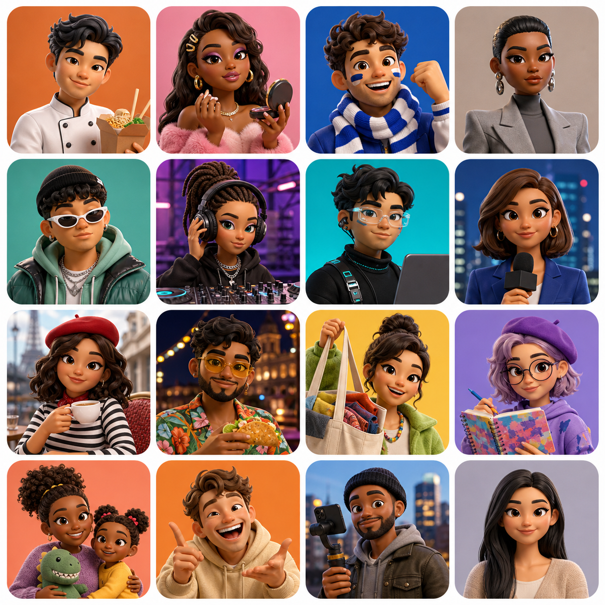

# Poplur fixture-user profile atlas

This is the visual and behaviour guide for Poplur’s **bundled fixture cast**.
They are local preview data, not Firebase accounts: they do not create server
posts, messages, calls, or purchases. The current test reset removed all such
backend content.

The atlas is read left-to-right, top-to-bottom.

| # | Fixture type | Current channel / representative handle | Behaviour in the product |
| --- | --- | --- | --- |
| 1 | Food creator | Food · `@sauceboss` | Short food discovery clips; a Toronto claim can lead to St. Lawrence. |
| 2 | Beauty creator | Beauty · `@glowgetter` | Makeup/tutorial channel presentation only; no simulated uploads. |
| 3 | Sports fan | Sports · `@pitchside` | Match-moment clip and BMO Field map rival. |
| 4 | Runway model | Modelling · `@runwayraw` | Backstage/editorial fashion channel fallback. |
| 5 | Street-fashion creator | Fashion · `@fitcheckdaily` | Outfit/fashion channel fallback and a world-board rival. |
| 6 | Music creator / DJ | Music · `@basement.set` | Warehouse-set channel fallback and a Junction map rival. |
| 7 | Tech creator | Tech · `@shipit` | Desk-setup/technology channel fallback and a Shanghai world rival. |
| 8 | Local reporter | News · `@localwire` | News-channel presentation fallback; actual News uses the live-news source. |
| 9 | French culture creator | French · `@paris.pov` / `@boulangerie` | Café/culture fallback and Paris world-board presence. |
| 10 | Spanish nightlife creator | Spanish · `@vibra.cdmx` / `@alpastor` | Food/nightlife channel fallback and Mexico City/Madrid world rivals. |
| 11 | Shopping creator | Shopping · `@hauls` | Sale/discovery channel fallback and a Yorkdale map rival. |
| 12 | Animator / illustrator | Cartoon · `@doodlecast` | Illustration/animation channel fallback and Leslieville map rival. |
| 13 | Family / kids creator | Kids · `@playtime` | Family-safe channel fallback and High Park map rival. |
| 14 | Comedy creator | Comedy · `@bitmerchant` | Sketch/comedy channel fallback and Beaches map rival. |
| 15 | City / live-events creator | Live · `@citydesk` / `@harbourfront` | World-board and city-event presentation; no real event is fabricated. |
| 16 | Neutral live creator | Live · `@you` | Empty-state representative for a current user’s local Live channel. |

## What “activity” means today

- **Map rivals and claim holders:** bundled `POIS` and `OTHER_POPS` are static
  display fixtures. They stay in place until real post data replaces them.
- **Feed cards:** bundled channel creatives are the deterministic fallback
  when no real published media is available.
- **Demo engagement:** a browser-only preview can emit one local like/view/
  comment every 6–14 seconds. It uses the fixture cast but writes no Firebase
  data. Native shells already suppress this cadence.
- **Preview guests and boards:** House and Conquer may use plainly marked
  examples when no authenticated nearby data exists.

## Testing rule

Live Simulation is off by default. It is currently operated only by Poplur's
private beta desk; there is no in-app Testing control in this release, and
ordinary testers cannot enable synthetic activity. Fixture art remains
distinguishable preview material until the corresponding live query has data.

## Source of truth

- Channel fixture definitions: `src/FeedTwin.tsx`
- Map rival/world fixture definitions: `src/data.ts`
- Browser-only engagement generator: `src/engagement.ts`
- Private beta simulation state: `src/simulationControl.ts`

The atlas was generated with the built-in image-generation workflow on
2026-08-29. It is fictional concept art only: no persona is a real account.
